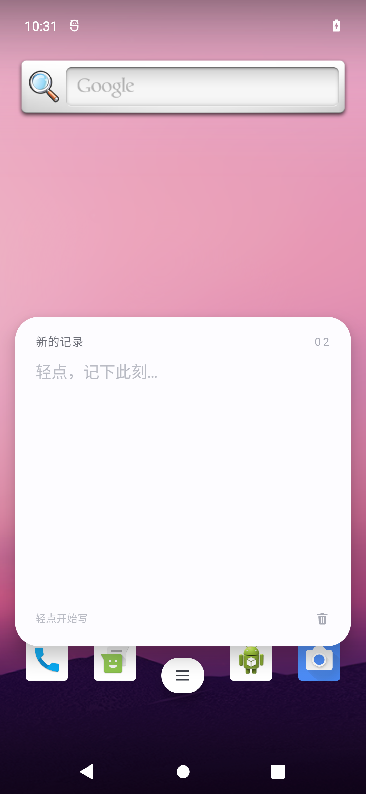
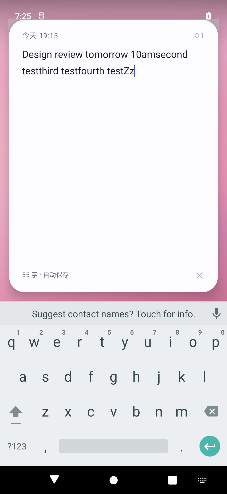
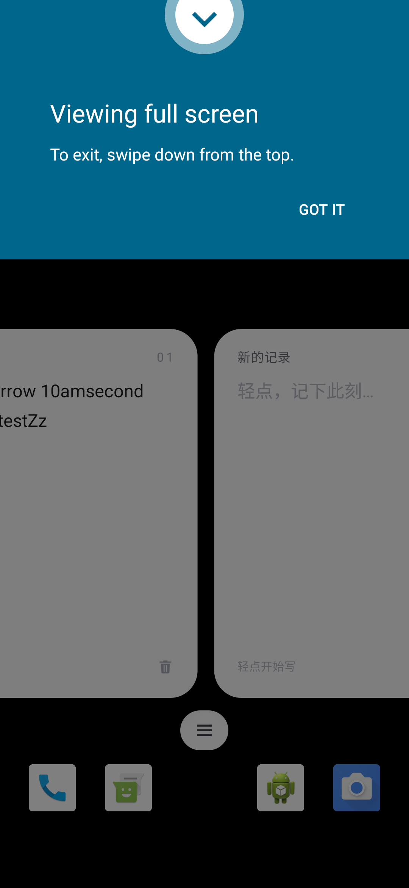

# SuiJi_Note · 随记

一张悬浮在桌面壁纸上的白色便签卡片。点一下就能写，写完自动保存，卡片外的一切保持原样。

不是全屏 App，也不是桌面小组件——是一个**透明窗口 + 卡片**的极简便签：打开时只在下半屏露出一张卡片，壁纸和桌面图标清晰可见，不压暗、不缩放。

<p align="center">
  
  
  
</p>

> 截图为 Android 12 模拟器实拍。拍于 v2.5，卡片编号还是 `01/02`，v2.6 起改为 `1/2`。

## 特性

- **透明弹窗卡片**：卡片外完全透明，桌面壁纸与图标原样可见，窗口不压暗、不缩放
- **半屏起始，聚焦上浮**：静息时卡片贴在下半屏；点击进入编辑后升到上半屏、贴住键盘，像一张书写纸
- **自动保存**：取消编辑、失去焦点、切后台都会落盘；没有「完成」按钮
- **水平列表式翻页**：左右滑动切换卡片，相邻卡片跟手同时可见，标准 ViewPager 手感；滑到末尾自动新建
- **多卡片管理**：底部抽屉预览全部记录，可跳转、长按删除、新建
- **网址识别**：正文里的链接自动标蓝下划线，点击弹窗选择复制或打开
- **不进多任务列表**：`excludeFromRecents`，卡片内容不会残留在最近任务预览里
- **零第三方运行时依赖**：原生 Java + Android View，无 Kotlin、无 AndroidX、无 Gradle

## 交互

| 操作 | 行为 |
| --- | --- |
| 轻点卡片 | 进入编辑 |
| 返回键 / 点卡片外 | 退出编辑并保存（编辑态点外部只收卡，不退出应用） |
| 非编辑态点卡片外 | 退出应用 |
| 左右滑动卡片 | 切换上一张 / 下一张，边缘有阻尼回弹 |
| 末尾继续左滑 | 新建一张空白卡片（停在浏览态） |
| 点右下角垃圾桶 | 清空当前卡片文字 |
| 长按右下角垃圾桶 | 删除当前卡片并退回上一张（只剩一张时忽略） |
| 点底部三横线 | 打开全部记录抽屉 |
| 抽屉内长按条目 | 确认后删除该条记录 |
| 抽屉内「＋ 新建」 | 追加空白卡片并跳转 |

## 下载安装

到 [Releases](../../releases) 下载最新的 `SuiJi_Note-v*.apk` 安装即可。

- 要求：Android 8.0（API 26）及以上
- 覆盖安装不会清掉已有记录
- Release 包使用项目自己的签名，后续版本可直接覆盖升级

## 从源码构建

不依赖 Gradle，一条命令：

```bash
export ANDROID_HOME=/path/to/android-sdk     # 需要 build-tools 与 platforms/android-*
./build.sh
# 产物：build/suiji.apk
```

脚本流程：`aapt2 compile/link → javac → d8 → zipalign → apksigner`。

签名默认在仓库根目录生成一个调试用 `keystore.jks`（已被 `.gitignore` 排除）。自己发布时用环境变量指定：

```bash
KS_PATH=/path/to/release.jks KS_PASS=****** KS_ALIAS=myalias ./build.sh
```

依赖：JDK 8+、Android SDK（build-tools 30+，platforms 任一 `android-*`）。

## 项目结构

```
AndroidManifest.xml          单 Activity、透明主题、不进最近任务
build.sh                     纯命令行构建脚本
src/com/suiji/note/
  MainActivity.java          窗口与几何、手势、翻页、抽屉、生命周期
  NoteCardView.java          卡片渲染：编辑切换、链接识别、触摸观察
  NoteStore.java             记录存储（本地文件 + JSON）
  Ui.java                    dp、键盘、系统栏尺寸等工具
  SuijiApp.java              全局异常兜底
res/
  layout/activity_main.xml   根布局、卡片容器、抽屉入口、抽屉面板
  layout/card.xml            卡片：编号、时间、清除按钮、正文、编辑框
  drawable/                  卡片、胶囊、面板、图标
  values/                    颜色、尺寸、主题
```

## 实现要点

**真正透明的窗口**：`Theme.Translucent.NoTitleBar` + 背景透明 + 清掉 `FLAG_DIM_BEHIND`；`setDecorFitsSystemWindows(false)` 后自接管 insets；Android 12+ 用透明的 SplashScreen 主题避免启动闪屏。Dialog 主题会把窗口重置成 `wrap_content`，所以窗口尺寸必须在 `setContentView()` 之后设置。

**触摸与手势**：卡片内部的 `ScrollView`、`TextView`（带 `LinkMovementMethod`）会吃掉点击事件。解决办法是在卡片层 `dispatchTouchEvent()` 里做一次「旁路观察」，把原始事件交给 Activity 统一判定，正文层不再拦截。

**翻页**：不用快照、不做串行动画。翻页时把相邻卡片作为**真实视图**挂到旁边，拖动时两张卡一起跟手位移，松手按位移（超过 1/3 卡宽）或速度决定落位或回弹。相邻卡片是用 `new NoteCardView()` 动态创建的，而 `card.xml` 是 `<merge>` 根——merge 不会触发 `onFinishInflate()`，所以控件绑定抽成幂等的 `init()`，构造器与 `onFinishInflate()` 都调用。

**编辑几何**：编辑态高度由 `WindowInsets.Type.ime()` 算出，卡片顶边固定、底边贴键盘；退出编辑时位移与高度收缩跑同一个 `ValueAnimator`，避免「先变形再掉落」。键盘收起过程中不改变卡片高度，形状统一交给下落动画。

## 已知限制

- **透明窗口在各家 ROM 上行为有差异**。主流程在 Android 9 / 12 验证过；Android 15 的厂商系统若出现启动闪退或界面不显示，欢迎带机型 + logcat 提 issue。
- 卡片数据存在应用私有目录，卸载即清空，暂无导入导出。
- 没有云同步、没有提醒、没有富文本——刻意保持极简。

## License

[MIT](LICENSE)
